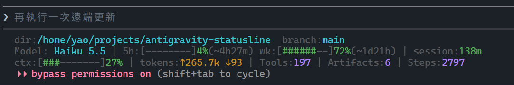

# Claude Statusline (繁體中文)

[English](README.md) | [繁體中文](README.zh-TW.md)

可自訂的 Claude Code 狀態列（Python 腳本），支援 **Windows、WSL、Linux 與 macOS**。欄位與版面和 [antigravity-statusline](https://github.com/yaochangyu/antigravity-statusline) 對齊，並加上**當前 session 的 token 用量**。



## 功能特色

- **目錄與分支**：目前目錄名稱、Git 分支、未提交變更標記（`*`），以及 ahead / behind 數量。
- **模型與額度**：模型名稱，以及 `5h` / `wk` 使用量進度條與重置倒數（Claude Code 提供 `rate_limits` 時顯示）。
- **用量**：今日與本月 token 用量（`↑` 輸入含快取、`↓` 輸出），透過 `ccusage` 取得並在背景快取；`ccusage` 無法執行時隱藏。
- **Session**：session 持續的分鐘數。
- **Context 與 Token**：context 使用率進度條，以及當前 session 的輸入（`↑`）與輸出（`↓`）token。
- **活動**：從 transcript 讀取目前使用的 skill、工具呼叫數、Artifacts（以 `Write` 工具寫入的不重複檔案數）與步驟數。
- **跨平台**：只使用 Python 標準函式庫。Windows 會自動啟用 ANSI 色彩並以 UTF-8 輸出。

輸出範例：

```
dir:/home/you/projects/my-project  branch:main*
  Model: Opus 5.5 | 5h:[##------]30%(~59m) wk:[#-------]10%(~1d0h) | today:↑8.4M ↓68.3k | month:↑1.2M ↓9.9k | session:12m
  skill:write-style | ctx:[####------]42% | tokens:↑152.3k ↓8.4k | Tools:2 | Artifacts:1 | Steps:3
```

> [!NOTE]
> - `today` / `month` 需要能以 `npx --no-install ccusage` 執行 ccusage，否則隱藏該欄位。
> - `5h` / `wk` 只有在 Claude Code 的 statusline 輸入包含 `rate_limits` 時才會出現。

## 系統需求與前置作業

- **Python 3.8+**：狀態列需要 Python 3。可用 `python3 --version` 確認是否已安裝（Windows 請用 `python --version`）。
  - Windows：到 [python.org](https://www.python.org/downloads/) 安裝，並確認 `python` 已加入 `PATH`。
  - WSL / Linux：`sudo apt update && sudo apt install -y python3`
  - macOS：`brew install python`
- **Git**（選用，用於顯示分支）

## 安裝步驟

### AI Agent 一鍵安裝提示詞 (Prompt)

若你使用 AI 程式助手（例如 Antigravity 或 Claude Code），可以複製以下提示詞，讓 agent 幫你安裝：

> 請幫我執行以下遠端 Python 安裝程式來安裝 claude-statusline：
> `python -c "import urllib.request; exec(urllib.request.urlopen('https://raw.githubusercontent.com/yaochangyu/claude-statusline/main/install.py').read())"`
> 執行後，請幫我確認 `~/.claude/settings.json` 中的 `statusLine` 設定。

### 1. 遠端一鍵安裝（推薦）

不需要 clone 儲存庫，直接用 Python 執行安裝程式：

```bash
python -c "import urllib.request; exec(urllib.request.urlopen('https://raw.githubusercontent.com/yaochangyu/claude-statusline/main/install.py').read())"
```

> [!TIP]
> - 在 Linux / macOS / WSL 上若預設指令是 `python3`，請把開頭改成 `python3 -c ...`。

### 2. 本地開發安裝（適用於開發者）

若你打算自訂狀態列，請 clone 儲存庫後執行本地安裝程式：

```bash
git clone https://github.com/yaochangyu/claude-statusline.git
cd claude-statusline
python install.py      # WSL / Linux / macOS 請用 python3 install.py
```

> [!NOTE]
> - Windows 與 WSL 各自有獨立的 `~/.claude/settings.json`，在兩邊使用 Claude Code 都要各執行一次安裝程式。
> - 若已有 `statusLine` 設定，安裝程式會覆蓋它；舊檔案會備份為 `settings.json.bak`。
> - 重新啟動 Claude Code（或開新 session）即可看到狀態列。

## 運作原理與配置

安裝程式會做兩件事：

1. 把 `statusline.py` 複製到 `~/.claude/statusline/statusline.py`（本地執行時從 repo 複製，遠端執行時從 GitHub 下載）。
2. 在 `~/.claude/settings.json` 設定 `statusLine`，指向上述副本。其他設定會保留。

設定結果如下：

```json
{
  "statusLine": {
    "type": "command",
    "command": "python3 \"/home/<you>/.claude/statusline/statusline.py\"",
    "padding": 0,
    "refreshInterval": 30
  }
}
```

> [!NOTE]
> - `refreshInterval` 每 30 秒重新執行一次狀態列，讓 session 閒置時 `today` / `month` 也保持最新；Claude Code 在對話事件發生時也會重新執行。
> - Windows 的 `settings.json` 不會展開 `~`，安裝程式會寫入加引號的絕對路徑，例如 `python "C:/Users/<你>/.claude/statusline/statusline.py"`。

### 手動設定

不使用安裝程式時，把上面的區塊加入 `~/.claude/settings.json`，並將路徑換成 `statusline.py` 的絕對路徑。

### Token 資料來源

1. `context_window.total_input_tokens` 與 `context_window.total_output_tokens`（session 累計值）。
2. 若沒有上述欄位，則加總 `context_window.current_usage`（包含 cache 讀寫）。

### 疑難排解

Claude Code 會把 session 資料以 JSON 經由 stdin 傳給狀態列。若要檢查內容，請加上傾印開關執行：

```bash
CLAUDE_STATUSLINE_DUMP=1 claude
```

然後查看 `~/.claude/statusline/last_stdin.json`。注意：只有在狀態列重繪時才會寫入。

## 更新腳本

### 1. 遠端一鍵更新（推薦）

不需要 clone 儲存庫。此指令會從 GitHub 下載最新的 `statusline.py`，覆蓋 `~/.claude/statusline/` 中的副本，並保留你的 `settings.json`：

```bash
python -c "import urllib.request; exec(urllib.request.urlopen('https://raw.githubusercontent.com/yaochangyu/claude-statusline/main/update.py').read())"
```

> [!TIP]
> - 在 Linux / macOS / WSL 上若預設指令是 `python3`，請把開頭改成 `python3 -c ...`。

### 2. AI Agent 一鍵更新提示詞 (Prompt)

若你使用 AI 程式助手（例如 Antigravity 或 Claude Code），可以複製以下提示詞，讓 agent 幫你更新：

> 請幫我執行以下遠端 Python 更新腳本，把 claude-statusline 更新到最新版：
> `python -c "import urllib.request; exec(urllib.request.urlopen('https://raw.githubusercontent.com/yaochangyu/claude-statusline/main/update.py').read())"`
> 完成後，請幫我確認 `~/.claude/settings.json` 中的 `statusLine` 設定。

### 3. 本地更新（適用於已有 clone 儲存庫的開發者）

若你先前已 clone 儲存庫，請拉取最新變更後執行更新程式：

```bash
git pull origin main
python update.py       # 或 python3 update.py
```

## 解除安裝

### 1. 遠端解除安裝

可以直接從 GitHub 執行解除安裝程式：

```bash
python -c "import urllib.request; exec(urllib.request.urlopen('https://raw.githubusercontent.com/yaochangyu/claude-statusline/main/uninstall.py').read())"
```

此指令會刪除 `~/.claude/statusline/statusline.py` 與執行時產生的檔案（`sessions.json`、`last_stdin.json`、`cache.json`、`statusline.lock`），並且只有在 `statusLine` 指向本工具時，才從 `~/.claude/settings.json` 移除該設定。寫入前會先備份。

### 2. 本地解除安裝

在 clone 下來的儲存庫目錄中執行解除安裝程式：

```bash
python uninstall.py    # 或 python3 uninstall.py
```
